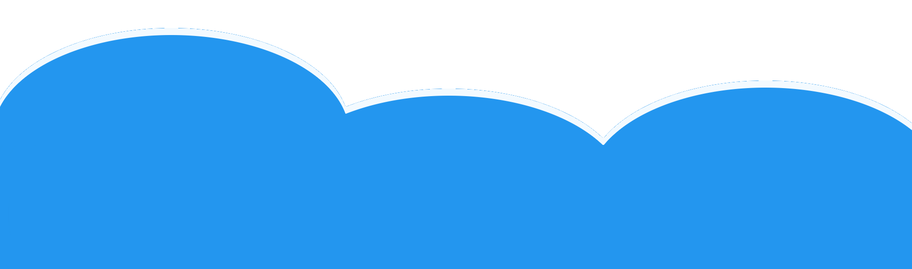

    

<h1 align="center">console.log('Hello World!')</h1>

 

## 👋 I am Michael from Germany

-   📜 In March 2024, I finished my bachelor's degree in Media Technology, specialising in Media Informatics, with a grade of 1.5.
-   🎓 In July 2026, I finished my master's degree in Applied Computer Science / Infotronics with a grade of 1.6.
-   📚 Programming-wise, I'm doing frontend web development with React and TypeScript.
-   🖥 I'm also familiar with backend development using Python/Django and PHP/Symfony, mobile development with React Native, and Raspberry Pis.
-   ♿ In my software design, digital accessibility takes priority over visual design in order to include as many people as possible.
-   ⚡ Besides programming, I enjoy doing sports, listening to music and going for walks in my free time.

 

## ⭐ Featured Project: Full Accessibility Audit

[Full Accessibility Audit](https://github.com/StackOverflowIsBetterThanAnyAI/full-accessibility-audit) is a GitHub Actions workflow that crawls a web application, including pages behind a login, and audits every page against WCAG 2.2 with axe-core and additional custom checks.

Measured against the official W3C ACT rules test cases, it reaches a precision of 100 % and a recall of 75 %.

 

## 📦 My Open Source Packages

-   [accessible-color-contrast](https://www.npmjs.com/package/accessible-color-contrast): CLI tool that checks two colors for a high enough contrast in the context of WCAG 2.2
-   [wcag-compliant-accessible-library](https://www.npmjs.com/package/wcag-compliant-accessible-library): WCAG 2.2 compliant components, closely based on the W3C techniques
-   [fetch-loading](https://www.npmjs.com/package/fetch-loading): loading animation that can be displayed while data is fetched from an API
-   [prettier-es5](https://www.npmjs.com/package/prettier-es5): Prettier settings for trailing commas, tab width, semicolons and single quotes

All my npm packages together are installed this often per month:

 

## 🛠 Technologies I Have Worked With

    
    
    
    
    
    
    
    
    
    
    
    
    
    
    

 

## 📈 My GitHub Statistics

 

## 👨‍💻 Codewars

-   **Leaderboard Position**: #3979 <!-- CODEWARS_LEADERBOARD -->
-   **Challenges Completed**: 922 <!-- CODEWARS_COMPLETED -->
-   **Overall Score**: 2710 <!-- CODEWARS_OVERALL_SCORE -->

### My Top 3 Languages

<!-- CODEWARS_LANGUAGE_RANKS:start -->

-   **JavaScript**: 3 kyu (score 2625)
-   **TypeScript**: 5 kyu (score 375)
-   **Python**: 6 kyu (score 138)

<!-- CODEWARS_LANGUAGE_RANKS:end -->

 

## 📫 Contact

You can reach me on [LinkedIn](https://www.linkedin.com/in/michael-m%C3%BCnzenhofer-31a092270/).

